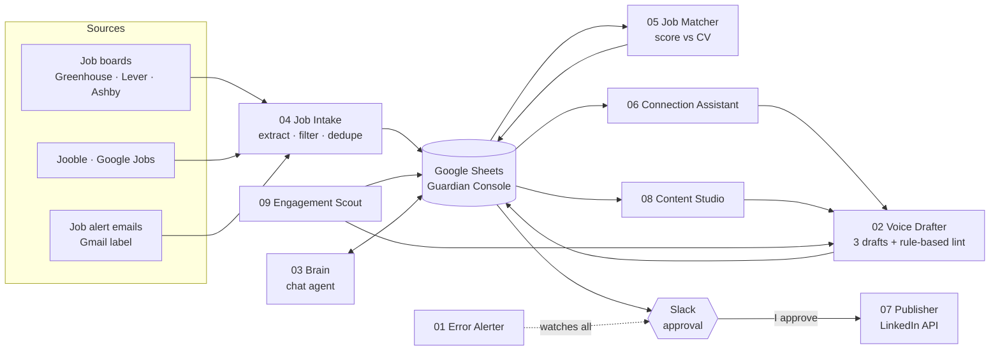

# LinkedIn Guardian

**A human-in-the-loop AI agent that runs my job search in Ireland.** It finds Business Analyst, Data Analyst and Associate Product Manager roles, scores each one against my CV, drafts outreach, posts and comments in my voice, and waits for my approval before anything leaves the system.

Built with **n8n**, **Groq** and **Gemini** (free tiers), **Google Sheets** as the console, and **Slack** for approvals. Runs in Docker.

> Nothing is ever sent, posted or connected automatically. The agent prepares; I decide.

---

## Why I built it

Job hunting in Ireland meant checking several job sites and a dozen alert emails every day, copying jobs into a sheet, judging which ones fit, and writing outreach from scratch. Most of that is repetitive. The judgement is not.

So I split the work: the agent does the collecting, scoring and first drafts, and I keep every decision that reaches another person.

## What it does

| Area | What happens | My part |
|---|---|---|
| **Job scouting** | Pulls jobs every hour from company job boards (Greenhouse, Lever, Ashby), Jooble, Google Jobs and the alert emails LinkedIn, Indeed, IrishJobs and Jobs.ie already send me | none |
| **Fit scoring** | Scores every job 0 to 100 against my Master CV: location, seniority, skills (judged by Gemini) and domain | read the strong fits |
| **Outreach** | Each morning picks the top matches (or a target company from my watchlist), drafts a connection note and builds people-search links | find the person, send it myself |
| **Content** | Writes the next episode of a build-in-public series, with an image brief | approve, reject with a reason, or add a screenshot |
| **Publishing** | Posts approved content through the official LinkedIn API, with the image if I added one | set status to Approved |
| **Engagement** | Three times a day finds relevant public posts and drafts a thoughtful comment for each | read the post, tweak, paste |
| **Learning** | Every rejection reason is logged and fed into the next draft | write why I rejected it |

## Architecture



### The nine workflows

| # | Workflow | Trigger | Job |
|---|---|---|---|
| 01 | Error Alerter | any failure | Posts the error to Slack and logs it to the sheet |
| 02 | Voice Drafter | called by others | Writes 3 drafts, lints them with code, retries once with the exact flags |
| 03 | Brain | chat | AI agent with tools to read jobs, save memory and draft text |
| 04 | Job Intake | hourly | Collects jobs from 4 source types, filters titles, dedupes against the sheet |
| 05 | Job Matcher | every 30 min | Scores new jobs against my CV |
| 06 | Connection Assistant | 08:30 and 18:00 | Outreach drafts, follow-up drafts, stale-request flags |
| 07 | Publisher | every 15 min | Posts Approved content, with image, max one post per 20 hours |
| 08 | Content Studio | hourly, daytime | Keeps two series drafts ready; rewrites rejected ones using my reason |
| 09 | Engagement Scout | 3 times a day | Finds posts to comment on and drafts the comments |

## Design decisions worth knowing

**Human approval on every outbound action.** The agent has no tool that can send a message or connection request. The Publisher only posts rows I marked Approved.

**LLM output is never trusted blindly.** Every draft goes through a deterministic lint written in plain JavaScript. It checks length, banned AI phrasing, dashes, hashtag and emoji rules, false claims about the project, and it rejects any number that does not appear in my written list of true facts. That last rule is what stopped the agent inventing results about me.

**Reading alert emails instead of scraping.** Job sites already email me jobs. Reading my own inbox is reliable and stays inside every site's terms. An LLM extracts each job as JSON, and code then checks that the title and link really appear in the email.

**Free tiers, paced instead of paid.** Groq's free tier allows 8,000 tokens per minute per model. Rather than paying, each job gets its own model, and calls are paced with a Loop and a Wait node. This forced cleaner, smaller prompts.

**The sheet is the source of truth.** Deduplication reads the sheet, not hidden workflow memory, so a failed run never loses or repeats a job.

More detail in [docs/DECISIONS.md](docs/DECISIONS.md).

## Problems I hit and fixed

A few of the real bugs, because they taught me the most:

- **Every Indeed link was identical.** My email cleaner cut URLs at the `?` to drop tracking, but Indeed stores the job ID there. Fixed by reading the `jk` parameter and rebuilding a clean link.
- **"Graduate Mechanical Engineer" in a data analyst pipeline.** The word "graduate" matched. Replaced per-source checks with one shared title filter that has a core list and a block list.
- **The chat agent kept calling its own drafting tool** and burned through the rate limit. Fixed with a clearer tool description, a hard iteration cap and a separate model per job.
- **The agent invented facts about me** (a report that did not exist, the wrong job title). Fixed with a written fact list in the prompt and a false-claim check in the lint.

Full list in [docs/BUILD_LOG.md](docs/BUILD_LOG.md).

## Tech stack

`n8n` · `Docker` · `JavaScript` (Code nodes) · `Groq` (gpt-oss-120b, Llama) · `Google Gemini` · `Google Sheets / Docs / Drive / Gmail APIs` · `Slack API` · `LinkedIn API` · `Serper` (Google search)

## Repository layout

```
workflows/   n8n workflow exports (sanitized: no credentials or IDs)
docs/        architecture, setup guide, design decisions, build log
templates/   Google Sheet column headers to recreate the console
tools/       sanitize.py: strips secrets from exports before publishing
screenshots/ canvas and console screenshots
```

## Run it yourself

See [docs/SETUP.md](docs/SETUP.md). In short: run n8n in Docker, create the Google Sheet from `templates/`, import the workflows, connect your own credentials, and replace every `YOUR_GOOGLE_ID` with your own IDs.

## Status

Running daily on my laptop; moving to an always-on Oracle Cloud VM next.

## About me

**Tushar Gaikwad**, MSc Business Analytics student at Dublin Business School, based in Galway. Previously Business Analyst, then Product Manager, in B2B healthtech SaaS. Looking for Business Analyst, Data Analyst and Associate Product Manager roles in Ireland.

[LinkedIn]https://www.linkedin.com/in/tushargaikwadba/

## License

MIT. See [LICENSE](LICENSE).
